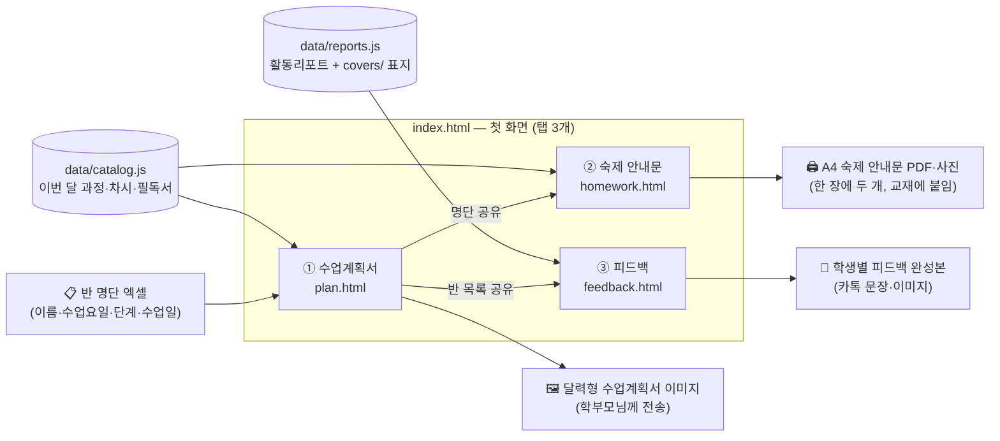

# 한우리 수업도우미

> **한우리독서토론논술 선생님이 반 명단 엑셀 하나로 ① 수업계획서 ② 숙제 안내문 ③ 학부모 피드백을 만드는 웹페이지예요.**
> 설치·로그인·서버가 필요 없어요. 브라우저로 열면 바로 쓸 수 있고, 어느 지부에서나 쓸 수 있어요.

---

## 한눈에 보기



| 탭 | 선생님이 넣는 것 | 나오는 것 |
|---|---|---|
| ① 수업계획서 | 반 명단 엑셀 | 반마다 달력 + 차시별 필독서가 들어간 이미지 (PNG, 여러 반은 zip) |
| ② 숙제 안내문 | 반 명단 + 숙제 (화면에서 바로 적거나 숙제 엑셀) | A4 가로 한 장에 안내문 두 개 → PDF 또는 사진. 장 수는 학생 수에 맞춰져요 |
| ③ 피드백 | 반 공통 피드백 한 번 + 학생별 체크(상·중·하)와 한마디 | 공통 + 개인이 합쳐진 학부모용 완성본 (문장 복사·이미지 저장·반 전체 모아 보기) |

**반 명단 엑셀은 한 번만 올리면 세 탭에 모두 들어가요.** 어느 탭에서 올려도 돼요.

**휴대폰에서 저장할 때:** 저장을 누르면 공유 창이 열려요(사진·파일에 저장). 공유 창을 쓸 수 없으면 그림이 크게 뜨니 길게 눌러 저장해요. 카카오톡에서 링크를 열면 그림 저장이 막혀 있어서, 휴대폰 기본 브라우저로 한 번 다시 열려요.

---

## 선생님 사용 순서

1. 위쪽 **양식·안내 받기**에서 반 명단 엑셀 양식을 받아 채워요. `수업월호` 칸에는 어느 달·호 계획안으로 수업하는지 적어요(예: 11월에 10월호 수업 → `10월`, 호 과정 → `2호`). 비워 두면 수업일의 달 계획안이 들어가요. 양식 안의 '작성 방법' · '과정 목록' 시트를 참고해요.
2. **① 수업계획서** 탭에 반 명단을 올리고 → 반마다 **이미지로 만들기** → 저장해서 학부모님께 보내요.
3. **② 숙제 안내문** 탭 2단계에서 과정별 숙제를 적고(또는 숙제 엑셀 올리기) → **PDF로 저장** → 인쇄해요.
4. **③ 피드백** 탭에서 반을 고르고 → 공통 피드백 → 학생마다 체크·한마디 → **문장 복사**해서 카톡으로 보내요.

---

## 관리자가 매달 할 일

| 언제 | 할 일 | 고칠 파일 |
|---|---|---|
| 매달 계획안이 나오면 | 이번 달 과정·차시·필독서 넣기. 매달 과정은 **최근 세 달만** 남기고 그 전 달은 지워요 | `data/catalog.js` |
| 활동리포트가 나오면 | 과정별 활동리포트 추가, 표지 그림 넣기. 매달 과정 리포트도 **최근 세 달만** 남겨요 | `data/reports.js`, `covers/` |
| 양식을 바꿀 때 | 엑셀 양식 교체 (파일 이름 = 메뉴 이름 그대로) | `forms/`, `index.html` 메뉴 |
| 고친 뒤 | GitHub `main`에 올리기 → 자동 점검 → 통과하면 사이트에 반영 | — |

### `data/catalog.js` 모양

```js
window.CATALOG = {
  "year": 2026, "month": 11,
  "courses": [{
    "name": "논리1",              // 화면·엑셀에 쓰는 짧은 이름
    "full": "논리리더1",           // 정식 이름
    "aliases": ["논리1", "논리리더1"], // 엑셀 '단계' 칸에 이렇게 적어도 알아봐요
    "kind": "monthly",            // monthly = 매달 바뀌는 과정, series = 호별 과정(몰입·세계사 등)
    "month": 10,                  // (선택) 지난달·다음 달 계획안을 같이 둘 때 그 달. 없으면 맨 위 "month"(기본 달)
                                  //   → 엑셀 수업일이 10월이면 10월 계획안, 11월이면 11월 계획안이 자동으로 골라져요
    "sessions": [{ "book": "필독서", "tag": "소주제", "desc": "한 줄 소개", "link": "교과 연계" }]
  }]
};
```

### `data/reports.js` 모양

```js
window.REPORTS = {
  "logic1_2026-11": {                       // 과정코드_연-월 (호별 과정은 mdP_ho02 처럼 호수)
    "stage": "논리리더1", "month": "2026-11", "period": "11월", "category": "정규과정",
    "sessions": [{ "no": "1", "book": "책 제목", "type": "읽기·쓰기", "result": "활동 내용",
                   "curriculum": "교과 연계", "cover": "s1529.jpg" }]   // 표지는 covers/ 폴더
  }
};
```

---

## 파일 구조

```
index.html            첫 화면: 탭 3개 + 탭끼리 반 명단 전달
plan.html             ① 수업계획서 화면 (HTML만)
homework.html         ② 숙제 안내문 화면
feedback.html         ③ 피드백 화면

css/
  base.css            모든 페이지 공통 색상·기본 모양 ← 색을 바꾸려면 여기만
  index.css · plan.css · homework.css · feedback.css   페이지별 모양

js/
  shim.js             파일 저장 도우미 (Claude 밖에서는 브라우저 다운로드로)
  shared.js           공통 도구: 엑셀 읽기, 반 나누기, 수업일 읽기, 과정 이름 맞추기, 탭끼리 메시지
  index.js            첫 화면: 탭 전환, 반 명단을 다른 탭에 전달
  plan.js · homework.js · feedback.js   페이지별 동작

data/
  catalog.js          이번 달 계획안 (과정·차시·필독서)  ← 매달 교체
  reports.js          피드백용 활동리포트                ← 매달 추가

covers/               피드백 이미지에 들어가는 책 표지
forms/                선생님이 받는 엑셀 양식과 사용 안내 PPT
scripts/check.mjs     올리기 전 자동 점검
.github/workflows/pages.yml   main에 올리면 점검 후 GitHub Pages에 배포
```

### 구조의 약속
- **HTML에는 화면 구조만**, 모양은 `css/`, 동작은 `js/`, 매달 바뀌는 자료는 `data/`에 둬요. (점검이 HTML 안의 스크립트를 막아요)
- 반 명단 엑셀을 읽는 규칙은 **`js/shared.js` 한 곳**에만 있어요. 엑셀 칸을 바꿀 때 여기만 고치면 세 탭이 같이 바뀌어요.
- 자료는 `fetch`가 아니라 `<script src>`로 불러요. 그래서 `index.html`을 **더블클릭해서 파일로 열어도** 돼요.
- 탭끼리는 `postMessage`로만 주고받아요 (파일로 열면 탭끼리 직접 부를 수 없기 때문).

---

## 데이터는 어디에 저장되나요?

- **서버에 아무것도 저장하지 않아요.** 엑셀과 학생 이름은 선생님 브라우저 안에서만 읽어요.
- 화면에 적은 숙제는 **그 기기의 브라우저(localStorage)에만** 남아요. 다른 기기·다른 선생님과는 공유되지 않아요.
- 피드백(공통·학생별)은 **저장하지 않아요.** 화면을 열어 둔 동안만 기억하고, 새로고침하면 모두 지워져요. 다 쓰면 복사하거나 이미지로 저장해서 보내요.

| 저장 이름 | 내용 |
|---|---|
| `hw_mem_v1` | 숙제 안내문: 달·과정별로 적은 숙제 |
| `fb_my_closings`, `fb_closing` | 피드백 인사말 |
| `suite_kakao_open` | 카카오톡에서 열었을 때 기본 브라우저로 한 번만 다시 열기 |
| `suite_tab` 등 | 마지막으로 연 탭·과정 |

---

## 점검과 배포

- `main`에 올리면 GitHub Actions가 `scripts/check.mjs`로 점검하고, 통과해야 GitHub Pages에 반영돼요.
- 올릴 때 페이지가 부르는 파일 주소 끝의 `?v=__V__`가 그때 버전으로 바뀌어요. 그래서 선생님들 휴대폰·컴퓨터가 예전 파일을 기억해 두지 않고 바로 새 버전을 받아요.
- 점검 내용: 화면 요소, 페이지가 부르는 파일, 외부 라이브러리 주소, 스크립트 문법, 과정 목록, 표지 그림, 엑셀 양식.
- **내 컴퓨터에 Node를 설치할 필요는 없어요.** 점검은 GitHub이 대신 해 줘요. 직접 돌려 보고 싶을 때만 Node를 설치하고 `node scripts/check.mjs`를 실행하면 돼요.
- 외부 라이브러리 (cdnjs): SheetJS(엑셀 읽기), html2canvas(이미지), jsPDF(PDF), JSZip(묶음 저장)

## 양식·안내 받기

- [사용 안내 PPT](forms/한우리_수업도우미_사용안내.pptx)
- [반 명단 엑셀 (이름으로 적기)](forms/반%20명단%20엑셀%20%28이름으로%20적기%29.xlsx)
- [반 명단 엑셀 (팀 이름으로 적기)](forms/반%20명단%20엑셀%20%28팀%20이름으로%20적기%29.xlsx) — 팀마다 한 줄, 인원 칸에 학생 수
- [숙제 엑셀 (빈칸)](forms/숙제%20엑셀%20%28빈칸%29.xlsx)
- [HTML 파일 하나로 받기](forms/한우리_수업도우미.html) — 인터넷 주소 없이 컴퓨터에서 바로 열어요. 페이지를 고치면 이 파일도 새로 만들어 넣어요.

GitHub 파일 화면에서는 오른쪽 위 **다운로드(↓)** 버튼을 누르면 받아져요.
